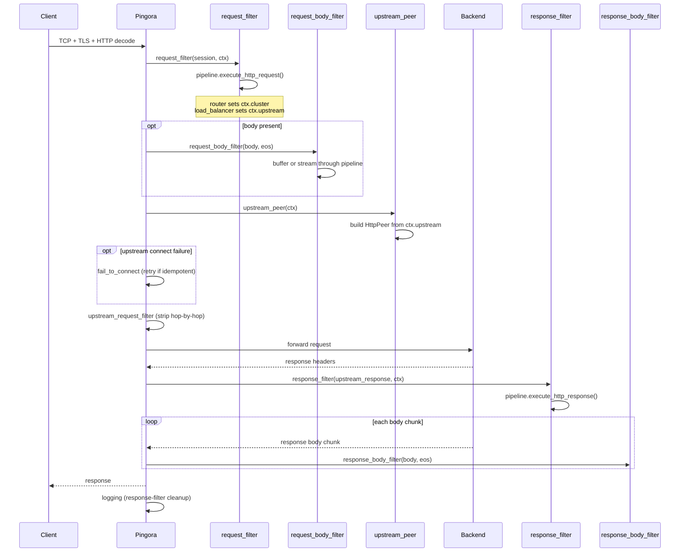

# Connection Lifecycle

## HTTP Connection Lifecycle

Request filters run in declared order and response filters in reverse.
`request_body_filter` runs only if a filter declares body access.
`response_body_filter` is `async`, but the `on_response_body` hooks it runs are
plain `fn`s.
`logging` re-runs the response filters when the response phase was skipped
(upstream error, filter rejection), and the upstream connection then goes back
to the pool. [Pingora Handler Lifecycle](pingora-handler-lifecycle.md)
describes each hook.

## TCP Connection Lifecycle

1. TCP accept, optional TLS handshake
2. `on_connect`: TCP filters run in order
3. Bidirectional byte forwarding to upstream
4. `on_disconnect`: TCP filters run on close

[TCP Proxy](tcp-proxy.md) covers SNI routing and timeouts.

## Related

- [Architecture Overview](overview.md)
- [Payload Processing](payload-processing.md)
- [HTTP Correctness](http-correctness.md)
