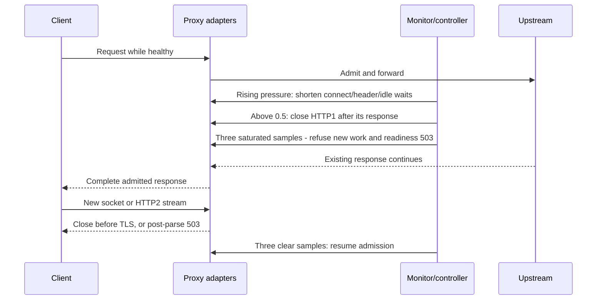

# Overload manager

[PR #1455](https://github.com/praxis-proxy/praxis/pull/1455) supplies the
resource monitors, pressure gauges, and smoothing for
[issue #145](https://github.com/praxis-proxy/praxis/issues/145).
[PR #1487](https://github.com/praxis-proxy/praxis/pull/1487) completes the
configurable thresholds and protective actions in
[proposal #28](https://github.com/praxis-proxy/enhancements/pull/28).

## Design

The existing monitor samples once per second on the housekeeping runtime.
Configurable bands map usage to pressure between zero and one; the EMA uses
30% new pressure and 70% previous pressure. Raw saturation and recovery each
require three consecutive samples, so readiness does not wait for the EMA to
approach one. Missing samples break those runs; ten missing samples exclude a
reading from actions while preserving its gauge.

Finite cgroup working-set pressure takes precedence over heap pressure.
Anonymous resident memory over the configured RSS cap is the fallback, and a
cap above the visible finite cgroup limit produces a startup warning. Only
cgroup-local CPU PSI drives actions; host CPU PSI remains observational.

`ListenerPipelines` owns one `Arc<Signal>` shared with its sampler, adapters,
and live readiness service. Reloading filters preserves this controller.
Handlers read its atomic snapshot without kernel reads, allocator calls, or
per-request controller allocation. Pressure and action gauges carry the
controller's `server` slot so concurrent servers cannot overwrite one
another's state.
Slots are reused after the final owner drops, bounding retained series by
peak concurrent controllers rather than sequential server lifetimes.

## Adapter boundaries

- Timeout factor is `1 - 0.9 * pressure`, with pressure rounded to 1% steps.
  Each attempt uses original configured connect/total-connect/idle budgets.
  A ten-second budget becomes 5.5 seconds at pressure 0.5 and one second at 1.
- Pingora uses its connection-filter hook before TLS and application wrappers
  before protocol probing/header parsing. Its body read budget is restored
  after parsing. Hyper checks accepted sockets before TLS and uses a separate
  HTTP/1 header timer, including for reused connections.
- Returned upstream connections receive shorter idle expiries; an unset idle
  timeout has a sixty-second baseline when actions are enabled. Already idle
  entries keep their scheduled expiry until reuse or expiration. Active
  connections, body/stream deadlines, and total TCP session limits are
  preserved.
- Sustained saturation also rejects post-parse HTTP requests/HTTP2 streams with
  503 and Retry-After, closes new TCP sessions, and fails `/ready`. Management
  listeners remain available and `/healthy` stays successful. Existing hard
  RSS, descriptor, and connection limits remain independent backstops.
- HTTP/1 keep-alive restores at pressure 0.4 or below. Response commitment
  rechecks pressure, including buffered/streamed terminal responses and
  HEAD/204/304 suppression. HTTP/2 receives no connection-specific header.
- Memory pressure requests one blocking allocator purge at a time per sampler.
  Missing callbacks start no worker, and the gauge reports completed success.
  Housekeeping drop cancels samplers and clears their controller. A running
  purge is joined after the network shutdown budget and may extend final exit.

For example, four admitted requests with a hard cap of five and saturation
ratio 0.80 trigger pressure refusal while one hard-limit permit remains free.
The fifth HTTP2 stream gets 503, the four admitted responses finish, and
three clear samples restore admission after they release their permits.

## Operating contract

Actions require the off-default `overload-actions` Cargo feature and both
`runtime.overload_gauges` and `runtime.overload_actions`. Flags and thresholds
require a restart. Configuration, defaults, and shutdown behavior are described
in [Configuration](../operating/configuration.md); action gauges and correlation
with in-flight work are described in
[Observability](../operating/observability.md). Independent body-buffer and
filter-hook attribution is reviewed separately in
[PR #1515](https://github.com/praxis-proxy/praxis/pull/1515).
