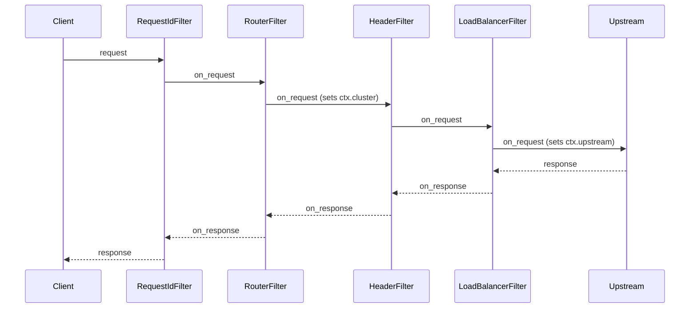
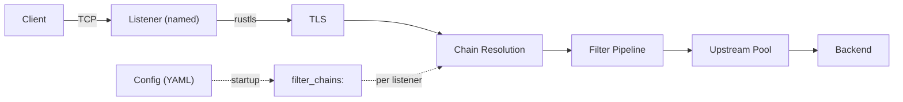
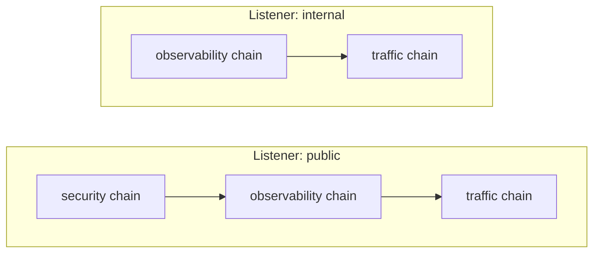
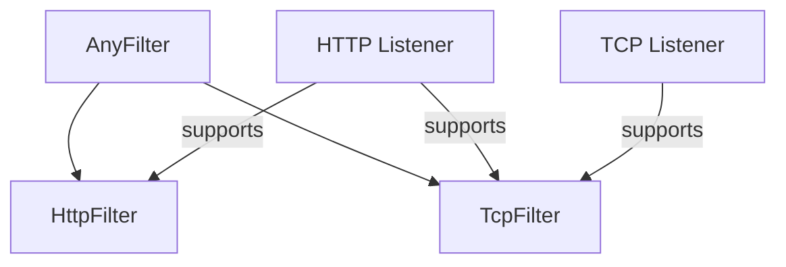

# Architecture Overview

## Design Principles

- **Fast** and **secure by default**: both are primary design goals.
- **Composable**: cluster routing, load balancing, rate limiting and
  body-based routing are all filters, using the same traits and assembled
  into pipelines through named chains.
- **Extensible**: your filters implement the same [`HttpFilter`] and
  [`TcpFilter`] traits as the built-in ones and register with one macro.
- **Adaptive**: Praxis is a framework for building proxies. Use a provided
  build, or compose your own proxy server from the same primitives.

[`HttpFilter`]:../filters/README.md
[`TcpFilter`]:../filters/README.md

## Primary Use-Cases

- **Ingress**: API gateway, edge proxy, traffic ingestion
- **Egress**: Workloads call Praxis; Praxis reaches configured
  upstreams
- **East/West**: Sidecar or colocated proxy next to a workload
- **Security gateway**: Guardrails, network policy,
  [identity, delegation, and authorization](../security/policy-enforcement.md)
- **AI inference and agents**: [AI Gateway][ai-overview] on
  `praxis-ai` (not the core `praxis` binary)

[ai-overview]: https://github.com/praxis-proxy/ai/blob/main/docs/overview.md

## System Architecture

### Protocol Adapters

Adapters translate upstream library callbacks into pipeline invocations.
Where it can, Praxis leaves protocol logic to the upstream library.

```text
HTTP  --> praxis-protocol/http  --> Pingora
TCP   --> praxis-protocol/tcp   --> Pingora
QUIC  --> praxis-protocol/http3 --> Quiche  (planned, not yet implemented)
```

A new protocol is a new adapter, and one protocol can have several
implementations, swapped by build feature or runtime configuration.

### Filter-First Design



Request filters run in declared order, response filters in reverse. Any
filter can short-circuit, and filters can read request and response bodies
to filter, route, cache or load-balance on them. See the
[filter system documentation] and, to write your own, the
[extensions guide].

[filter system documentation]:../filters/README.md
[extensions guide]:../developing/extensions.md

### Listeners



Each listener has a `name` and a list of `filter_chains`. Filter chains
are named groups of filters defined at the top level of the config. At
startup, a listener's chains are concatenated in order into one pipeline
(**pipelining**). This differs from **routing**, where the `router` filter
picks an upstream cluster at request time from path, host, and headers.

### Filters

Listeners can share chains. A "security" chain can run on public listeners
while internal listeners skip it:



#### Protocol-Aware Filters

HTTP filters implement `HttpFilter` (`on_request`, `on_response`, body
hooks); TCP filters implement `TcpFilter` (`on_connect`, `on_disconnect`).
The `AnyFilter` enum wraps both so one pipeline can hold either.
`ProtocolKind::stack()` and `supports()` enforce compatibility: an HTTP
listener accepts HTTP and TCP filters, a TCP listener only TCP filters.



### What Stays Outside Filters

See [What Stays Outside Filters](../filters/README.md#what-stays-outside-filters).

## Dynamic Configuration Reload

Praxis swaps filter pipelines at runtime without a restart. Each handler
holds an `Arc<ArcSwap<FilterPipeline>>` and calls `pipeline.load()` once per
request, pinning that snapshot for the request's lifetime. A reload stores a
new pipeline into the `ArcSwap`: the next request gets it, while in-flight
requests drain on the old one.

A file watcher (`notify` crate, 500ms debounce) monitors the config file. On
change it validates the new config, rebuilds all pipelines, and swaps them.
If validation fails, nothing changes. Each successful reload cancels the
health check tasks and respawns them with a fresh registry. Pipelines are
swapped one listener at a time, so two listeners may briefly run different
generations.

Changes that cannot apply live (listener topology, compression module, TLS
toggle) are found by diffing the old and new configs and logged as
warnings. Some changes reject the whole reload, such as a protocol change on
a bound listener or a change to a bound TCP listener's upstream. The full
lists are in [Dynamic Configuration Reload](../operating/configuration.md#dynamic-configuration-reload).

## Related

- [Pipeline Concepts](pipeline-concepts.md)
- [Life of a Request](life-of-a-request.md)
- [Connection Lifecycle](connection-lifecycle.md)
- [Payload Processing](payload-processing.md)
- [Crate Layout](crate-layout.md)
- [HTTP Correctness](http-correctness.md)
