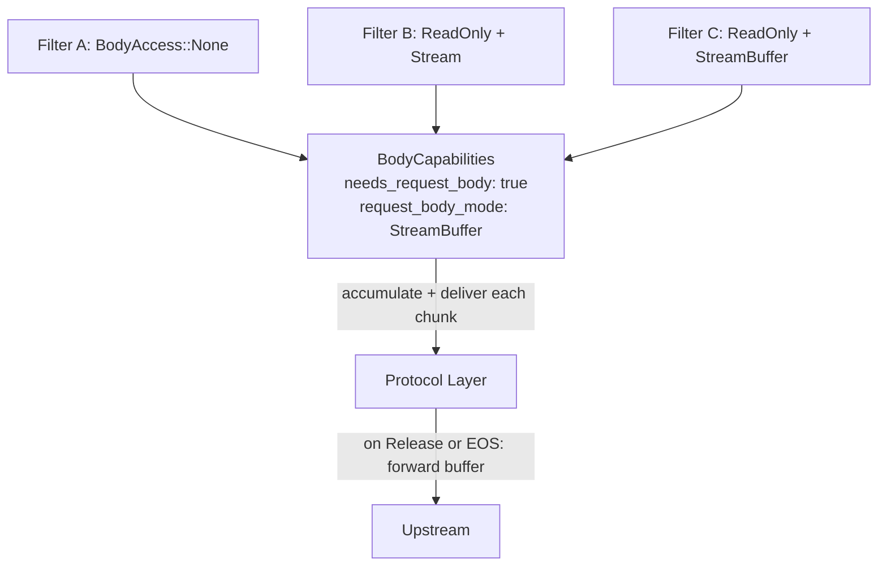

# Payload Processing

Filters declare body needs at construction time through
`request_body_access()`, `response_body_access()`, and the matching
`*_body_mode()` methods. The pipeline computes the aggregate
`BodyCapabilities` at build time so the protocol layer knows whether to buffer
or stream.

Two delivery modes matter to filters:

- **Stream**: chunks flow through filters as they arrive. Low latency, low
  memory.
- **StreamBuffer**: chunks reach filters as they arrive but are held in a
  buffer, not forwarded, until a filter returns `FilterAction::Release` or
  end-of-stream; later chunks then stream. The protocol layer pre-reads the
  body during the request phase, before upstream selection, so body filters
  can influence routing; the pre-read body is forwarded once the upstream
  connection is established. This supports protocol parsing, body-based
  routing, content scanning, and payload inspection, and
  [praxis-ai][ai-overview] builds its AI request classification on it.

[ai-overview]: https://github.com/praxis-proxy/ai/blob/main/docs/overview.md

Precedence is `StreamBuffer` > `SizeLimit` > `Stream`: one filter requesting
`StreamBuffer` makes the pipeline buffer. Global
`body_limits.max_request_bytes` / `body_limits.max_response_bytes` (10 MiB by
default) cap transfers, and buffered bodies also obey
`body_limits.max_buffer_bytes` (64 MiB by default) and any tighter filter
`max_bytes`. An oversized request returns 413; an oversized response is
aborted if headers were already sent. Removing the transfer limit requires
`insecure_options.allow_unbounded_body`, and buffering stays clamped to the
cap. When no filter requests body access, the pipeline counts bytes in
`SizeLimit` mode; an explicitly declared `Stream` mode stays streaming.

`on_response_body` is synchronous: the `HttpFilter` trait declares it as a
plain `fn`, though Pingora's `response_body_filter` callback is `async fn`.

Mode merging, `BodyBuffer`, and how the limits layer are in
[Body Buffering and StreamBuffer](body-buffering.md).

## Filter Condition System

Each `FilterEntry` carries optional `conditions` (request phase) and
`response_conditions` (response phase). A `when` runs the filter only if its
predicate matches; an `unless` skips it if the predicate matches.

Request conditions gate `on_request` and the body hooks; response conditions
gate only `on_response` and the response body hooks. The predicates and how
they combine are in
[Conditional Execution](../filters/README.md#conditional-execution).

## Related

- [Architecture Overview](overview.md)
- [Connection Lifecycle](connection-lifecycle.md)
- [Filter System](../filters/README.md)
