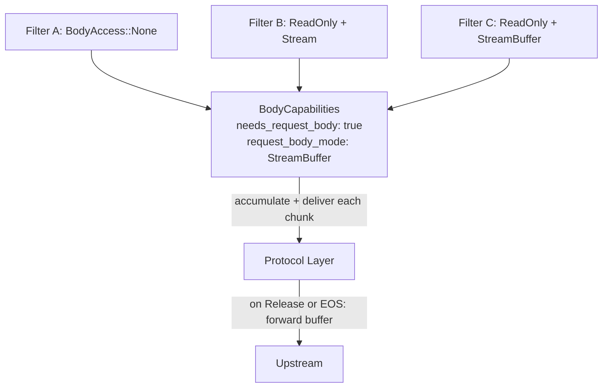

# Payload Processing

Filters declare body access needs at construction time via
`request_body_access()`, `response_body_access()`, and the
corresponding `*_body_mode()` methods. The pipeline
pre-computes aggregate `BodyCapabilities` at build time so
the protocol layer knows whether to buffer or stream.

Two delivery modes:

- **Stream**: chunks flow through filters as they arrive.
  Low latency, low memory.
- **StreamBuffer**: chunks are delivered to filters
  incrementally (like Stream) but accumulated in a buffer
  and not forwarded to upstream until a filter returns
  `FilterAction::Release` or end-of-stream. After release,
  remaining chunks flow through in stream mode. The default
  transfer limit is 10 MiB per request or response. Buffered
  bodies also obey `body_limits.max_buffer_bytes`, which
  defaults to 64 MiB. An optional filter `max_bytes` can set a
  tighter limit. An oversized request returns 413; an oversized
  response fails delivery and is aborted if headers were already
  sent. Explicitly removing the transfer limit while declaring
  an unbounded buffer requires
  `insecure_options.allow_unbounded_body`; buffering is still
  clamped to the configured cap. This mode enables streaming
  inspection with deferred forwarding for protocol parsing,
  body-based routing, and security use cases including content
  scanning and payload inspection. [praxis-ai][ai-overview]
  builds on the same StreamBuffer model for AI request
  classification.

[ai-overview]: https://github.com/praxis-proxy/ai/blob/main/docs/overview.md

When StreamBuffer mode is active, the protocol layer
pre-reads the body during the request phase (before
upstream selection) so that body filters can influence
routing decisions. The pre-read body is stored and
forwarded to the upstream after the connection is
established.

Precedence: `StreamBuffer` > `SizeLimit` > `Stream`. If
any filter requests `StreamBuffer`, the pipeline uses
stream-buffered mode.
Global `body_limits.max_request_bytes` /
`body_limits.max_response_bytes` enforce transfer limits.
When no filter requests body access, the pipeline counts
bytes in streaming `SizeLimit` mode. An explicitly declared
`Stream` mode stays streaming.

The `on_response_body` hook is synchronous (not async):
the `HttpFilter` trait declares it as a plain `fn`, even
though Pingora's own `response_body_filter` callback is
`async fn`.

## Filter Condition System

Filters can be conditionally executed based on request or
response attributes. Each `FilterEntry` carries optional
`conditions` (request phase) and `response_conditions`
(response phase).

Condition types:

- **`when`**: execute the filter only if the predicate
  matches
- **`unless`**: skip the filter if the predicate matches

Request predicates: `path`, `path_prefix`, `methods`,
`headers`. Response predicates: `status`, `headers`. All
fields within a predicate use AND semantics; multiple
conditions short-circuit in order.

Request conditions gate both `on_request` and body hooks.
Response conditions gate only `on_response` and response
body hooks.

## Related

- [Architecture Overview](overview.md)
- [Connection Lifecycle](connection-lifecycle.md)
- [Filter System](../filters/README.md)
